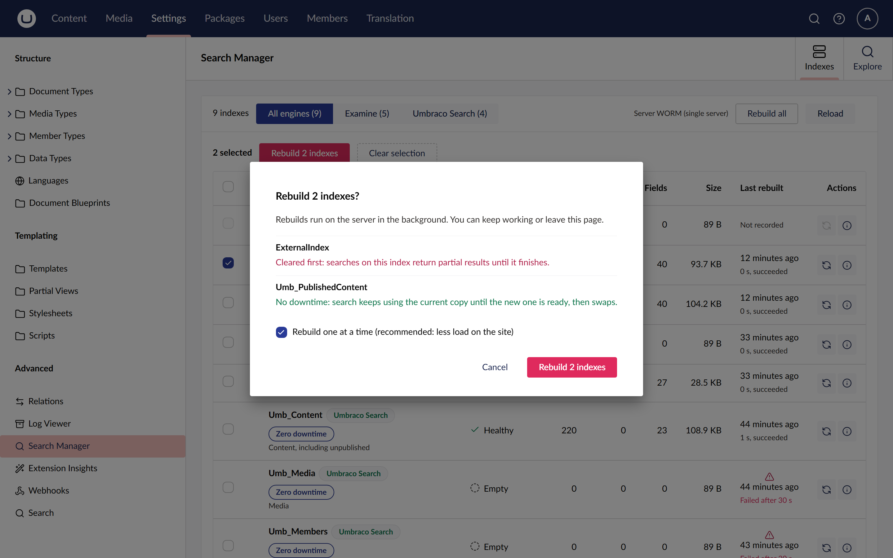
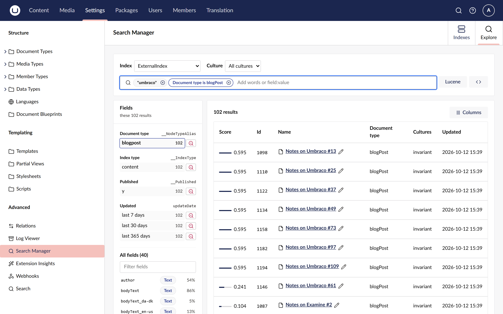
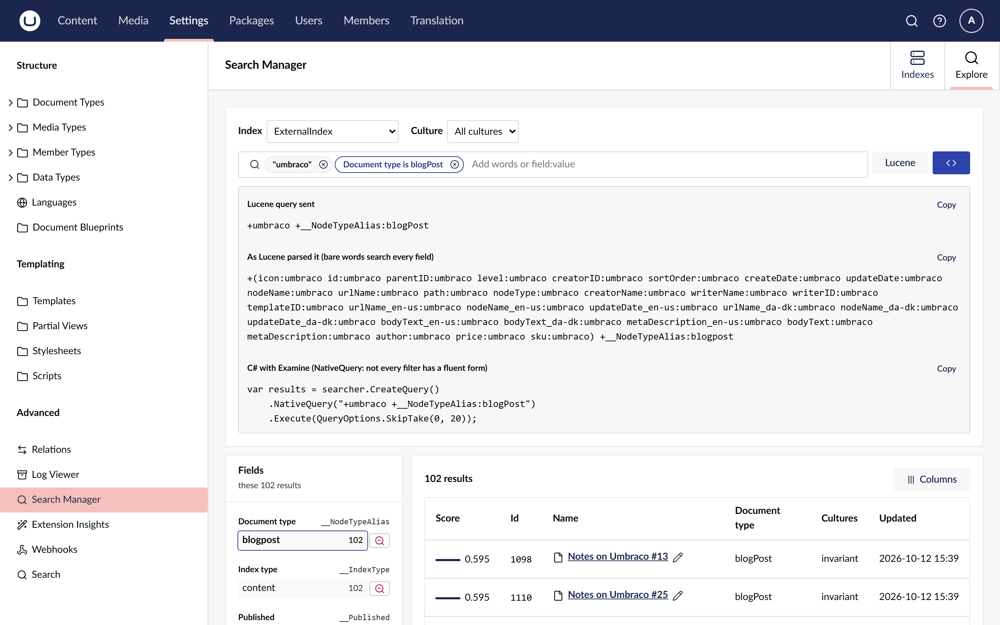

# Umbraco Search Manager

A search index manager for the Umbraco backoffice and a drop-in replacement for the Examine
Management dashboard. Install the package and it takes the dashboard's place under Settings, with
every index on one page and no configuration. On top of that, you can rebuild several indexes at
once in a queue that keeps running when you leave the page, see who rebuilt what and when, and
search any index with click-to-filter chips instead of hand-written Lucene.

[](https://www.nuget.org/packages/Umbraco.Community.SearchManager)
[](https://github.com/worm-brain/Umbraco.SearchManager/actions/workflows/ci.yml)
[](LICENSE)


## Contents

- [Features](#features)
- [A quick tour](#a-quick-tour)
- [Install](#install)
- [Quick start](#quick-start)
- [Configure](#configure)
- [Compatibility](#compatibility)
- [Documentation](#documentation)
- [Contributing, security and licence](#contributing-security-and-licence)

## Features

**See every index at a glance**

- **One table for every index.** Health, documents, deleted documents, fields, size on disk and
  the last rebuild, for core Examine indexes, custom indexes and, with the adapter package,
  Umbraco Search indexes. A corrupt index is listed with its error instead of breaking the page.
  [Check index health](docs/how-to/check-index-health.md)
- **A details sidebar** for each index, with its rebuild history and its provider properties.
- **Load-balanced sites are called out.** The view names the server you are on, and warns that a
  core Examine rebuild only affects that server.

**Rebuild without babysitting the page**

- **Bulk rebuilds.** Tick several indexes, or choose **Rebuild all**, and run them one at a time
  or all at once. The core dashboard rebuilds one index per click.
  [Rebuild indexes](docs/how-to/rebuild-indexes.md)
- **Know what happens to live search first.** The confirmation says, for each index, whether
  search returns partial results while it rebuilds or keeps using the current copy until the new
  one is ready.
- **A server-side queue.** Rebuilds keep running when you leave the page or close the browser.
  Queued runs can be cancelled, and the **Rebuilds** panel shows progress live, with an estimate
  from the previous run.
- **Rebuild history,** kept in the database: the last 20 runs per index with who started them,
  how long they took, the document counts and the error of a failure.

**Search an index without writing Lucene**

- **Filter chips.** Type words, `type:blogPost`, `-published:n` or `updated:>-7d`. Each becomes a
  chip you can edit or remove, with operators that suit the field: ranges for numbers and dates,
  phrases and "starts with" for text. [Search an index](docs/how-to/search-an-index.md)
- **Suggestions as you type:** field names with their type and coverage, then a field's most
  common values with counts.
- **A fields panel** with the top values of document type, index type, published and updated.
  Click a value to filter on it, or its minus to exclude it.
- **A document drawer** with every stored field of a result, grouped into system fields,
  properties and culture variants, with **Filter for** and **Filter out** on each value.
- **Cultures.** Pick a culture and chips search that culture's variant of each field.
- **The whole view is in the URL,** so a link or a reload reopens exactly what you saw.

**Learn Lucene as you go**

- **Show query** shows the Lucene your chips send, the query as Lucene parsed it, and C# with
  Examine that runs the same search, each with **Copy**.
  [Use raw Lucene](docs/how-to/use-raw-lucene.md)
- **Raw Lucene mode** checks the query as you type, marks where it fails to parse, and offers
  one-click fixes for common mistakes such as a lower-case `and` or a date without a range.
  **Back to filters** turns the query into chips again.

**Umbraco Search, side by side**

- With the `Umbraco.Community.SearchManager.UmbracoSearch` package, Umbraco Search indexes join
  the table with a **Zero downtime** badge, an engine filter, rebuilds, history and Explore.
  [Use it with Umbraco Search](docs/how-to/use-with-umbraco-search.md)
- Umbraco Search's own index page gets a **Search Manager** box with the last rebuild and links
  to Explore and the index's history.

### Coming next

- **Diagnose:** field statistics, analyzers and where a page is indexed.

## A quick tour

**Rebuild several indexes at once.** The confirmation says what happens to live search for each
index before anything starts.



**Watch them finish.** The Rebuilds panel follows each run from the server, and keeps going if
you leave.


**Search with chips.** Words and `field:value` filters become chips, and the fields panel shows
what the results contain.



**Open a document.** The drawer shows every stored field, with filter buttons on each value.


**See the query.** Every search shows the Lucene it sends and the C# that runs it with Examine.



## Install

The package comes in one line per Umbraco major: `17.x` versions for Umbraco 17 and `18.x`
versions for Umbraco 18. Pick the line that matches your site:

```sh
# Umbraco 17
dotnet add package Umbraco.Community.SearchManager --version 17.0.0

# Umbraco 18
dotnet add package Umbraco.Community.SearchManager --version 18.0.0
```

On a site that uses [Umbraco Search](https://github.com/umbraco/Umbraco.Cms.Search), add the
adapter too, at the same version:

```sh
dotnet add package Umbraco.Community.SearchManager.UmbracoSearch --version 17.0.0
```

Use the newest version of your line listed on
[NuGet](https://www.nuget.org/packages/Umbraco.Community.SearchManager). Without `--version`,
`dotnet add package` picks the newest version overall, which is the `18.x` line.

## Quick start

1. Install the package and run the site. The first start adds one database table for the rebuild
   history.
2. Sign in as a user with access to the Settings section and open
   **Settings > Advanced > Search Manager**.
3. Tick two indexes, choose **Rebuild 2 indexes**, read what happens to live search, and confirm.
4. Choose **Explore**, type `type:` and pick a document type to see what the index holds for it.

No configuration is needed. The tutorial [Find out why a page is missing from search](docs/tutorials/find-a-missing-page.md)
walks through a real job with screenshots.

## Configure

The one setting lives under `SearchManager` in `appsettings.json`. The core Examine Management
dashboard is hidden by default; to keep it as well:

```json
{
  "SearchManager": {
    "HideCoreExamineDashboard": false
  }
}
```

The [configuration reference](docs/reference/configuration.md) lists every setting and its
default.

## Compatibility

| Umbraco | Package line | Umbraco Search, for the adapter | .NET |
| ------- | ------------ | ------------------------------- | ---- |
| 17.x    | `17.*`       | 17.2.0 or later                 | 10   |
| 18.x    | `18.*`       | 18.2.0 or later                 | 10   |

Umbraco 16 and earlier are not supported. The main package never references Umbraco Search, so
installing it does not upgrade Examine.

## Documentation

The full documentation is in [`docs/`](docs/index.md):

- **Tutorial:** [find out why a page is missing from search](docs/tutorials/find-a-missing-page.md)
- **How-to guides:** [check index health](docs/how-to/check-index-health.md),
  [rebuild indexes](docs/how-to/rebuild-indexes.md),
  [search an index](docs/how-to/search-an-index.md),
  [use raw Lucene](docs/how-to/use-raw-lucene.md),
  [use it with Umbraco Search](docs/how-to/use-with-umbraco-search.md) and
  [keep the core Examine dashboard](docs/how-to/keep-the-core-examine-dashboard.md)
- **Reference:** [configuration](docs/reference/configuration.md),
  [search syntax](docs/reference/search-syntax.md) and the
  [Management API](docs/reference/api.md)
- **Explanation:** [how rebuilds work](docs/explanation/how-rebuilds-work.md) and the
  [security model](docs/explanation/security.md)

## Contributing, security and licence

- [CONTRIBUTING.md](CONTRIBUTING.md) explains how to build both Umbraco majors and run the tests.
- [SECURITY.md](SECURITY.md) explains how to report a vulnerability privately.
- [CHANGELOG.md](CHANGELOG.md) lists every user-visible change.
- Licensed under the [MIT licence](LICENSE).
