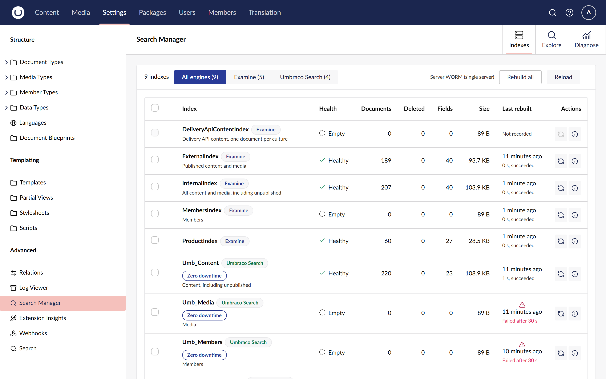
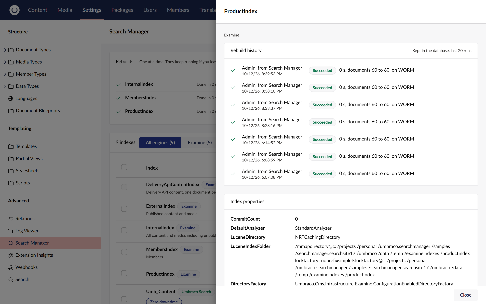

# Check index health

The **Indexes** view lists every search index on the site with its health and size, so you can
spot an empty, corrupt or stale index without opening each one.

## Open the Indexes view

1. Sign in as a user with access to the Settings section.
2. Open **Settings > Advanced > Search Manager**. The **Indexes** tab opens first.

Member indexes such as `MembersIndex` are listed only for users who also have access to the
Members section.

## Read the table

Each row is one index. The badge beside its name says which engine runs it: **Examine** or
**Umbraco Search**. Under the name is what the index holds, such as "Published content and media".

| Column | What it shows |
| --- | --- |
| **Health** | The index's state. See [Health labels](#health-labels). |
| **Documents** | How many documents the index holds. |
| **Deleted** | Documents marked deleted but not yet merged away. A high number is harmless; a rebuild clears it. |
| **Fields** | How many distinct fields the index has written. |
| **Size** | The index's size on disk. |
| **Last rebuilt** | When the last recorded rebuild finished, how long it took and whether it succeeded. **Not recorded** means no rebuild has been recorded yet. |
| **Actions** | Rebuild this index, and open its details. |

### Health labels

| Label | Meaning |
| --- | --- |
| **Healthy** | The index opens and answers searches. |
| **Empty** | The index opens but holds no documents. That is expected for `MembersIndex` on a site without members. |
| **Rebuilding** | A rebuild is running, from Search Manager or elsewhere. |
| **Queued for rebuild** | A Search Manager rebuild is waiting its turn. |
| **Unhealthy** | The index opens but the engine reports a problem, shown under the label. |
| **Corrupted** | The index cannot be read, so it is probably corrupt or locked. The error is shown under the label. Rebuild it. |
| **Unknown** | The engine did not say. |

A corrupt index is listed with its error instead of breaking the page.

## Filter by engine

With the Umbraco Search adapter installed, the view has an engine filter: **All engines**,
**Examine** and **Umbraco Search**, each with its count. Choose one to list only that engine's
indexes.

## Open an index's details

Choose the information button in the **Actions** column. The sidebar shows:

- **Rebuild history:** the last 20 rebuilds, newest first, with who started each one, when, how
  long it took, the document counts before and after, the server, and the error of a failure.
- **Index properties:** what the index reports about itself, such as its analyzer and folder.

## Check which server you are on

The line beside **Rebuild all** names the server you are on and its role, such as
**Server WEB01 (single server)**. On a site with more than one server, a banner above the table
says that rebuilding a core Examine index only rebuilds it on this server. See
[How rebuilds work](../explanation/how-rebuilds-work.md#load-balanced-sites).

## Related

- [Rebuild indexes](rebuild-indexes.md)
- [Use it with Umbraco Search](use-with-umbraco-search.md)
- [The security model](../explanation/security.md)
