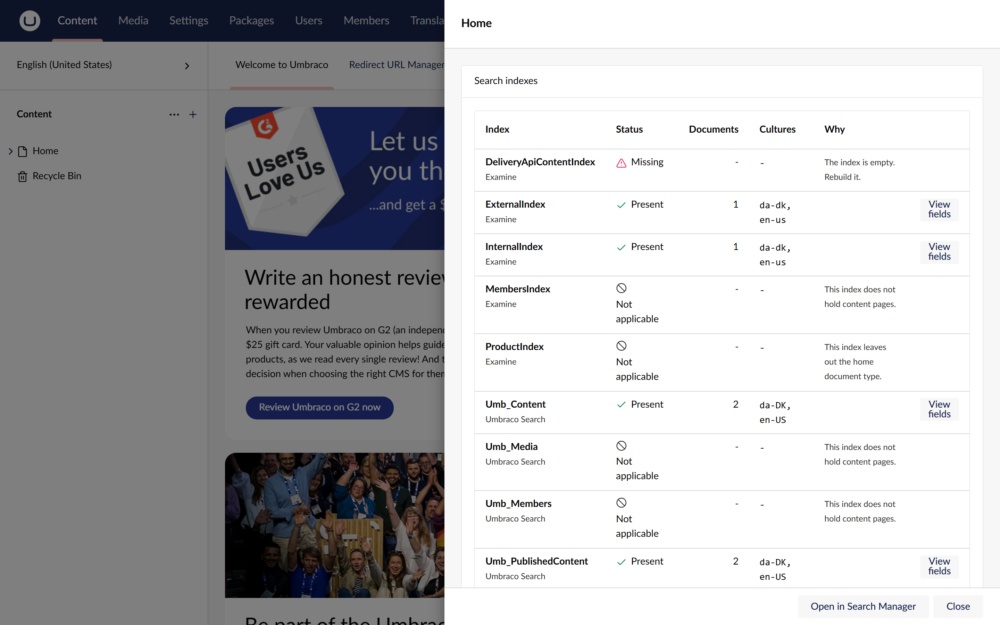
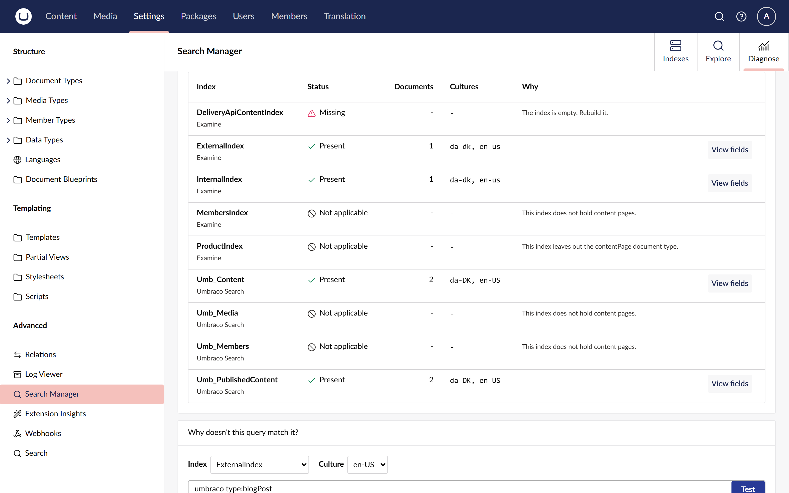

# Find where a page is indexed

**Diagnose > Find a node** takes one page and checks every index for it: which hold it, which
do not and why, and whether a copy is out of date. It then tests a search against the page, chip
by chip, to show which part of the query misses it.

## Look a page up

1. Go to **Settings > Advanced > Search Manager**, open the **Diagnose** tab and choose
   **Find a node**.
2. Type the page's name, its id or its key, and pick it from the list.

Or start from the page itself: in the content tree, open the page's actions and choose
**Show in search indexes**. A sidebar shows the same table, with a link to open it in Search
Manager. The action is shown to users with access to the Settings section.

## Read the table

Each index is one row, with its status in words and an icon:

| Status | Meaning |
| --- | --- |
| Present | The index holds the page. The cultures it holds are listed; Umbraco Search keeps one document per culture. |
| Missing | The index could hold the page but does not. The reason says why. |
| Not applicable | The index never holds a page like this one: it holds members, media or other document types. |

The reasons for a missing page come from the index's own rules, checked in this order:

1. The index is empty: rebuild it.
2. The page is not published, and the index only holds published content (`ExternalIndex`).
3. The page is in the recycle bin, which the index leaves out.
4. The page is outside the part of the content tree the index holds.
5. Public access protects the page, and the index leaves protected content out.
6. None of these: the index is out of date. Rebuild it.

A **Stale** tag means the index's copy is older than the page: the page was saved or published
after the index last wrote it. Hover it to see both dates. Published-only indexes are compared
with the publish date, because saving a draft never reaches them.

**View fields** opens **Explore** on that index with the page's document open in the drawer.

## Test a search against the page

Under the table, choose an index that holds the page, a culture if the page varies, and type
the search as you would in Explore, for example `umbraco type:blogPost`. Press Enter.

- The verdict says whether the whole search finds the page.
- Each chip says **matched** or **not matched** on its own, with the page's value of that field.
  A chip the index cannot run is marked as skipped, with the reason.

Chips on the same field are alternatives (either value matches), so the whole search can find a
page that some of its chips do not match on their own.

## Related

- [Read field statistics](read-field-statistics.md)
- [Rebuild indexes](rebuild-indexes.md)
- [Find out why a page is missing from search](../tutorials/find-a-missing-page.md)
- [ADR 0019: find a node](../adr/0019-find-a-node.md)
