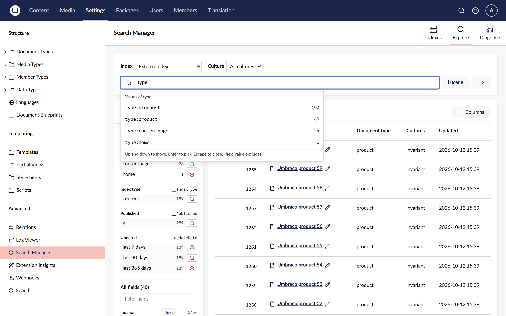

# Search an index

The **Explore** view searches any index, or any registered searcher, with filter chips. You type
words and `field:value` filters, and click values to narrow the results. You do not need to know
Lucene.

## Open Explore

1. Open **Settings > Advanced > Search Manager** and choose the **Explore** tab.
2. Choose an index in **Index**. Searchers are listed with "(searcher)" after their name.

With no filters, Explore lists every document in the index, newest first.

## Search with words and filters

Type into the search box and press Enter. Each part of what you typed becomes a chip:

- Words become one text chip that searches every field.
- `field:value` becomes a filter on that field, for example `type:blogPost` or `published:y`.
- `-field:value` excludes matches, for example `-type:product`.
- `"a phrase"` matches the words in that order.
- `level:>2`, `updated:>-7d` and `created:<2026-01-01` compare numbers and dates.

Short names such as `type`, `name` and `updated` stand for Umbraco's own fields. The
[search syntax](../reference/search-syntax.md) lists every form and short name.

Two chips on different fields must both match. If you leave a quote open, the whole input is
searched as plain text and a message says why.

#A chip the index cannot run is struck through, with the reason on the chip. After a search, a
chip the server left out is struck through the same way.

## Edit or remove a chip

- Click a chip to edit it. Change the **Operator**, the **Value**, or tick **Exclude matches**,
  then choose **Apply**. The operators on offer suit the field's type: numbers and dates get
  ranges, text gets "contains", "has the phrase", "starts with" and "is like".
- Choose the cross on a chip to remove it.

A chip that cannot run is struck through, with the reason in its tooltip. For example, a field
the index does not have.

## Let suggestions write the filter

As you type, a list suggests:

- **Fields**, with their type and how many documents have them.
- **Values of** a field once you have typed its name and a colon, with how many documents hold
  each value. Dates get relative ranges such as **last 7 days**.

Press the up and down arrows to move through the list, Enter to pick, and Escape to close it.

## Narrow with the fields panel

The **Fields** panel shows the top values of document type, index type, published and updated,
with counts. It counts the whole index when there are no filters, and the current results when
there are.

A field is counted without its own filters, so after you pick a document type the other types
stay listed with the counts they would add. Excluded values stay excluded. Values show as the
editor wrote them, such as `blogPost`, although the index stores and matches them in lower case.

- Click a value to filter on it.
- Choose the minus beside a value to exclude it.
- **All fields** lists every field with its type and coverage. Choose one to add a filter on it.

## Open a document

Choose a result's name to open the document drawer beside the results. It lists every stored
field, grouped into **System**, **Properties**, **Culture variants** and raw copies.

- Choose **Filter for** or **Filter out** beside a value to add it as a chip.
- Choose **Open in editor** to edit the content item, or **Copy as JSON** to copy the document.

The pencil beside a result's name opens the item in its editor straight away.

## Explain a score

In the document drawer, choose **Explain score** to see why the result scored as it did. Each
part of the score gets a line:

- **Words and phrases** found in a field, with how often they occur and the numbers Lucene
  multiplies: term frequency (`tf`), how rare the word is across the index (`idf`) and how short
  the field is (field norm). Rarer words in shorter fields score higher.
- **Must match** filters on keyword, number and date fields. They decide what matches, and in
  Lucene they add the same amount to every result they match.
- **Must not match** filters, which add no score.
- **Coord**, when only some of the optional words matched.

When the results are sorted newest first (filters only, no words), nothing ranks them, and the
drawer says so instead. Scores cannot be explained for indexes that are not Lucene indexes, or for
Umbraco Search indexes, which return no scores.

## Compare two results

Tick **Compare** on two results, then choose **Compare scores**. A table lists each part of the
score for both documents side by side, with the difference, largest first. Turn on
**Differences only** to hide the parts they share.

## Choose the columns

Choose **Columns** to add any field in the index as a column, not only fields on the current page.
Results come 20 to a page, with paging under the table.

## Search one culture

On a site with more than one language, choose a culture in **Culture**. Chips then search that
culture's variant of each field, such as `nodeName_en-us`, where the index has one.

Umbraco Search indexes start on the site's default language, because without a culture they find
only content that does not vary. Choose **No culture (invariant content only)** to search that.

## Share what you see

The index, culture, chips, columns, page and open document are all in the page address. Copy it
to share the view, or reload to get it back.

## Related

- [Search syntax](../reference/search-syntax.md)
- [Use raw Lucene](use-raw-lucene.md)
- [Use it with Umbraco Search](use-with-umbraco-search.md)
