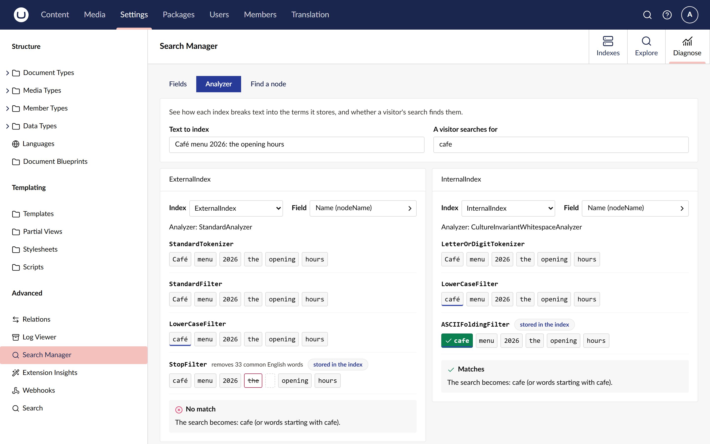

# See how an index analyzes text

**Diagnose > Analyzer** runs a piece of text through an index's own analyzer, step by step, and
tells you whether a search finds it. Use it when a search misses a page that plainly contains the
word: the index may have stored the word differently from how the visitor typed it.

## Analyze a text

1. Go to **Settings > Advanced > Search Manager** and open the **Diagnose** tab.
2. Choose **Analyzer**.
3. In **Text to index**, type the text as an editor would enter it, such as a page name.
4. In **A visitor searches for**, type what a visitor would search for.

Two indexes are shown side by side, `ExternalIndex` and `InternalIndex` by default, so you can
compare them. Pick another index or field in either column. The field decides the analyzer: a
text field of `ExternalIndex` uses `StandardAnalyzer`, while `InternalIndex` uses
`CultureInvariantWhitespaceAnalyzer`.

## Read the steps

Each row is one step of the analyzer, starting with the tokenizer, which splits the text into
terms; each later row is a filter. The last row is what the index stores, and the only terms a
search can find.

- A **struck-through** term was removed by that step, such as `the` in `StopFilter`, which drops
  common English words.
- A **marked** term was changed by that step, such as `Café` lower-cased to `café`, or folded to
  `cafe` by `ASCIIFoldingFilter`.
- A **highlighted** term with a tick is one the search looks for; "starts with" means the search
  looks for terms beginning with it.

The text and the search are kept in the address, so you can share the link.

## Read the verdict

Under the steps, **Matches** or **No match** says whether the search finds the text. Search
Manager builds the query the engine itself would run for the search and runs it against the
text, so the verdict follows the engine's rules. **The search becomes** lists what the query
looks for.

Some rules worth knowing:

- Core Examine does not analyse searches shorter than 4 characters: it looks for the term exactly
  as typed, case included, so `the` or `Caf` find nothing.
- Longer searches match whole words or the start of a word: `open` finds `opening`.
- `ExternalIndex` keeps accents, so `cafe` does not find `Café`; `InternalIndex` folds them.
- A search made only of words the analyzer removes finds nothing.

## Umbraco Search indexes

With the adapter package, Umbraco Search indexes on the Examine provider can be analyzed too.
The first field, **All text (what a search query reads)**, is the field a free-text search
reads: every word of the search must be found, as a whole word or the start of one. Text fields
are judged as a text filter would search them. Keyword fields are analyzed but not judged,
because keyword filters compare whole values.

Searchers that read several indexes, indexes that are not Lucene indexes, number and date fields
and Umbraco Search providers other than Examine say why they cannot be analyzed instead.

## Related

- [Read field statistics](read-field-statistics.md)
- [Find where a page is indexed](find-where-a-page-is-indexed.md)
- [ADR 0023: real analyzers stage by stage, verdict from the engine's own query](../adr/0023-analyzer-stages-and-engine-verdict.md)
