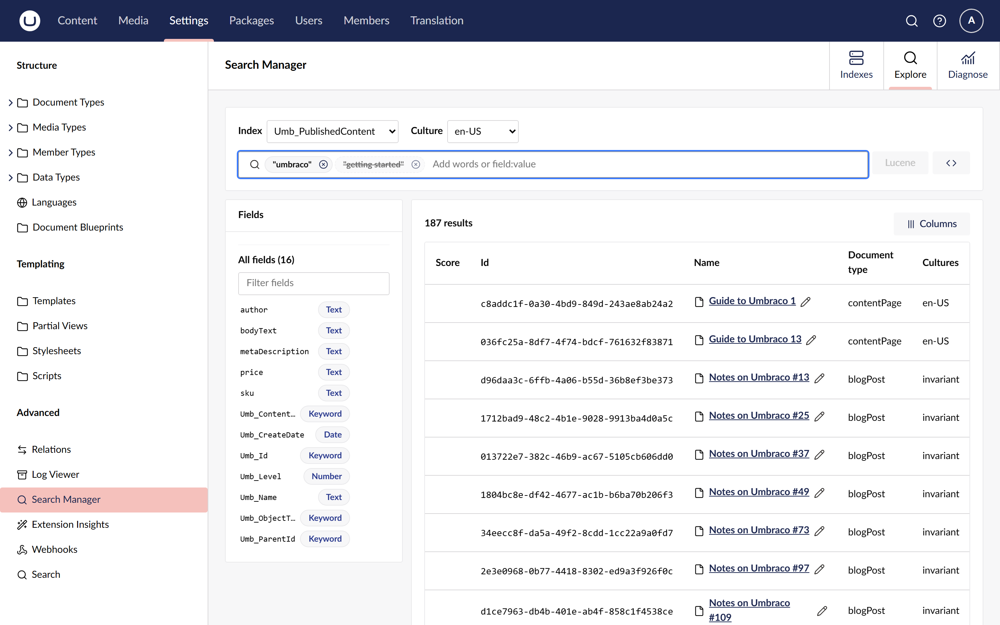
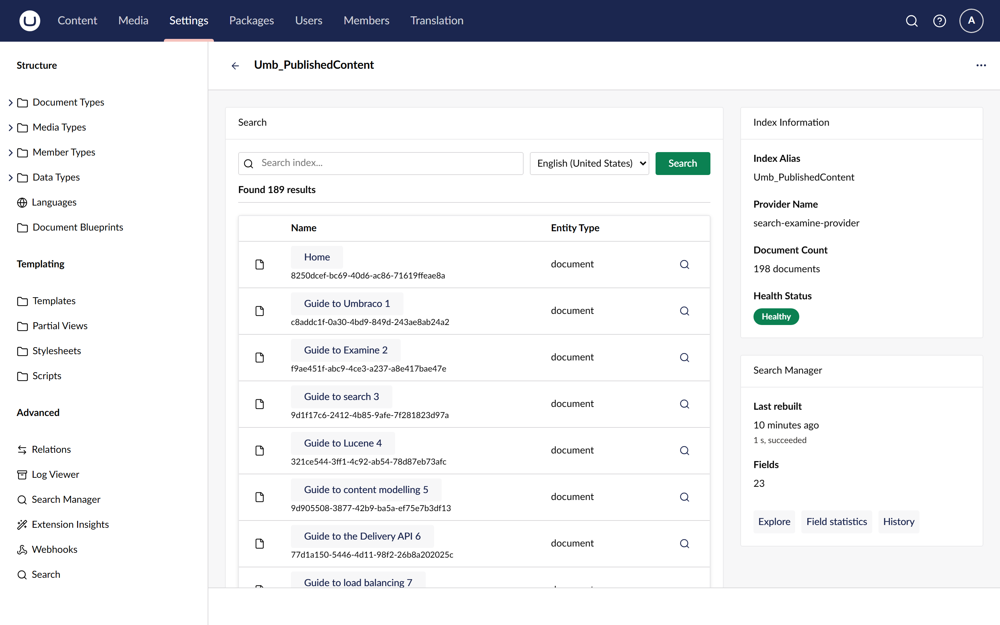

# Use it with Umbraco Search

[Umbraco Search](https://github.com/umbraco/Umbraco.Cms.Search) is Umbraco's newer search
framework. Its indexes are not core Examine indexes, so the main package does not see them. Add the
adapter package and they join the **Indexes** and **Explore** views beside the core indexes.

## Install the adapter

On a site that already has Umbraco Search set up, add the adapter at the same version as the main
package:

```sh
dotnet add package Umbraco.Community.SearchManager.UmbracoSearch --version 17.0.0
```

It needs Umbraco Search 17.2.0 or later on Umbraco 17, or 18.2.0 or later on Umbraco 18. No
configuration is needed. The main package never references Umbraco Search, so a site without the
adapter keeps the Examine version Umbraco ships with.

## What changes in the Indexes view

- Umbraco Search indexes such as `Umb_PublishedContent` are listed with an **Umbraco Search**
  badge, Umbraco Search's own health and document count, and a **Zero downtime** badge when they
  rebuild without downtime.
- With Umbraco Search's Examine provider, fields, deleted documents and size on disk come from the
  index copy that search is using right now.
- The physical Lucene indexes behind them are not listed a second time.
- An engine filter appears: **All engines**, **Examine** and **Umbraco Search**.
- Rebuilds go through Umbraco Search's own rebuilder, which rebuilds the index on every server.
  Rebuilds started from Umbraco Search's index page are recorded in the history too.

See [Check index health](check-index-health.md) and [Rebuild indexes](rebuild-indexes.md).

## Search an Umbraco Search index

Choose the index in **Explore** as usual. The chips run through Umbraco Search's own search, not
raw Lucene, so a few things differ:

- **Pick a culture.** Without one, Umbraco Search finds only documents that do not vary by
  culture.
- **Words** become the search query. Text, keyword, number and date chips become typed filters,
  and excluded chips negate them.
- **A document type chip** shows the alias, and sends the document type's key.
- **Some chips cannot run** and are struck through with the reason, and not sent: phrases,
  "starts with", "is like", "is missing", excluded words and raw Lucene. The results line says how
  many filters were not sent.
- **Show query** shows the Umbraco Search request in C#.
- **The drawer** shows the stored fields when the index uses the Examine provider.
- **Raw Lucene mode** is not available.



The short names differ from the core indexes: `type`, `kind`, `name`, `updated`, `created`, `key`,
`parent`, `path`, `level` and `sort`. See the [search syntax](../reference/search-syntax.md#short-names).

## The box on Umbraco Search's index page

Umbraco Search's own index page, under **Settings > Search**, gets a **Search Manager** box with
the last rebuild, the runs before it and the field count. Its buttons open **Explore**,
**Field statistics** and **History** for that index in Search Manager.



**Field statistics** opens the **Diagnose** tab, which is a placeholder in this version.

## Related

- [How rebuilds work](../explanation/how-rebuilds-work.md)
- [Search an index](search-an-index.md)
