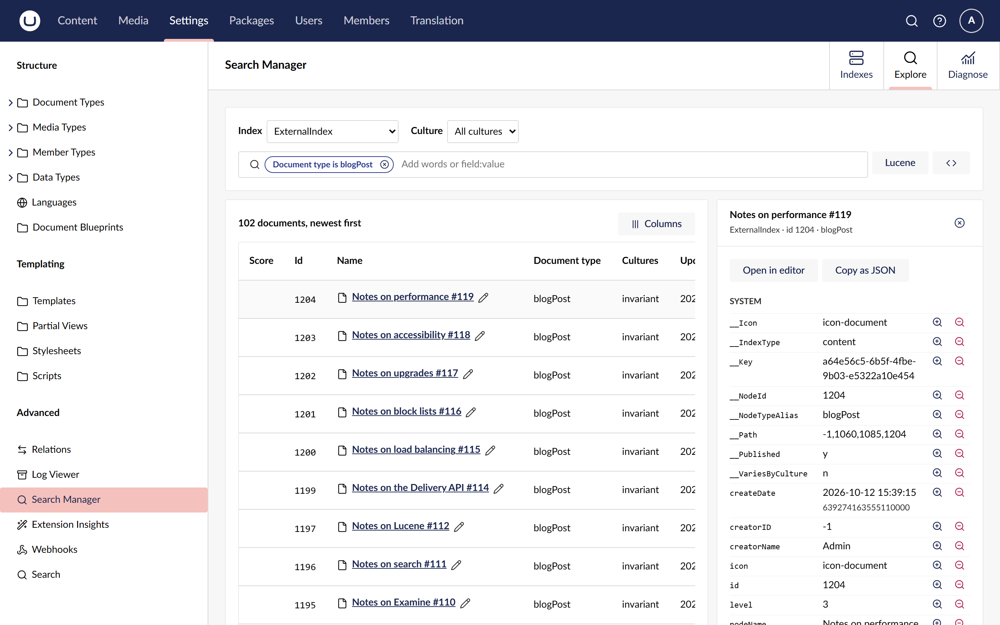
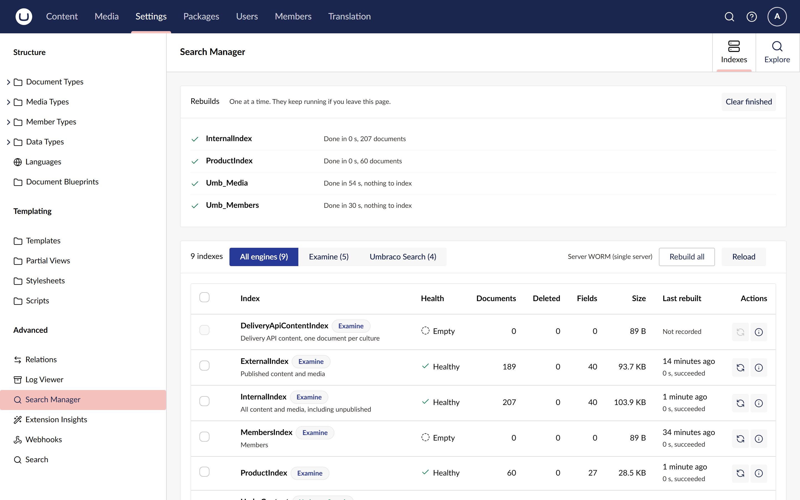

# Find out why a page is missing from search

An editor says a page does not show up in the site search. In about ten minutes, this tutorial
takes you through finding out why with Search Manager: whether the page is in the index at all,
why not, which part of the search misses it, and how to bring the index up to date.

You need a site with Search Manager installed, and a user with access to the Settings section. The
steps use `ExternalIndex` and `InternalIndex`, the core Examine indexes every Umbraco site has.
Most site searches query `ExternalIndex`.

## 1. Find the page in every index

1. Open **Settings > Advanced > Search Manager** and choose the **Diagnose** tab.
2. Choose **Find a node**.
3. Type the first words of the page's name, such as `Getting started`, and pick the page from the
   list.

A table lists every index with the page's status in it: **Present**, **Missing** or **Not
applicable**.

- **`ExternalIndex` says Present?** The page is in the index. Go to
  [step 3](#3-find-the-part-of-the-search-that-misses-it).
- **It says Missing?** Carry on with step 2.

You can get to the same table from the page: in the content tree, open its actions and choose
**Show in search indexes**.

## 2. Read why it is missing

The reason beside `ExternalIndex` comes from the index's own rules:

- **The page is not published.** `ExternalIndex` only holds published content, while
  `InternalIndex` (Present) holds drafts too. Publish the page and you are done.
- **The page is in the recycle bin,** or **outside the part of the tree this index holds:** the
  page is not meant to be found there.
- **It should be here: the index is out of date.** Nothing keeps the page out, so the index
  missed an update. Go to [step 4](#4-rebuild-the-index).

A **Stale** tag on a present row means the same thing for a page the index holds: its copy is
older than the page.

## 3. Find the part of the search that misses it

The page is in the index, so the question is which part of the site's search does not match it.

1. Under the table, choose `ExternalIndex` and, if the page has several languages, its culture.
2. Type the search the way the site runs it, for example `getting started type:contentPage`, and
   press Enter.
3. Read the verdict, then each chip: **matched** or **not matched**, with the page's own value of
   that field. A chip that does not match points at the field the site search reads, or at a
   value the editor expected but the page does not hold.

To see everything the index stored for the page, choose **View fields** in the table. **Explore**
opens on that index with the page's document in the drawer: every stored field, with **Filter
for** and **Filter out** beside each value.

## 4. Rebuild the index

1. Choose the **Indexes** tab.
2. Tick `ExternalIndex` and choose **Rebuild 1 index**.
3. Read the confirmation. `ExternalIndex` is **Cleared first**, so site searches return partial
   results until the rebuild finishes. On a busy site, do this at a quiet time.
4. Choose **Rebuild index**.

The **Rebuilds** panel follows the rebuild. You can leave the page while it runs. When it says
**Done in**, every document is committed and searchable.

Go back to **Diagnose**: the address bar kept the page, so the browser's back button gets you
there, and `ExternalIndex` now says **Present**.

## What you learned

- **Find a node** checks every index for a page and says why it is missing.
- `ExternalIndex` holds published content only; `InternalIndex` holds drafts too.
- Testing a search chip by chip shows which part of it misses the page, and with which value.
- A rebuild runs on the server, and **Done** means the index is ready to search.

## Next steps

- [Find where a page is indexed](../how-to/find-where-a-page-is-indexed.md): every status and
  reason.
- [Search an index](../how-to/search-an-index.md): every way to filter and narrow results.
- [Rebuild indexes](../how-to/rebuild-indexes.md): bulk rebuilds and the history.
- [How rebuilds work](../explanation/how-rebuilds-work.md): what a rebuild does to live search.
